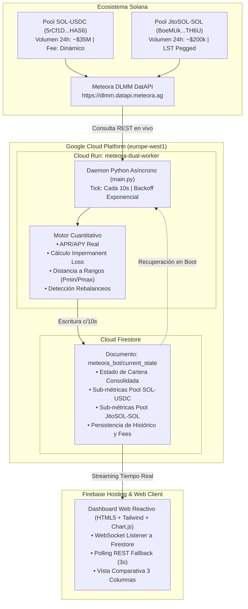

# CriptPool — Motor de Liquidez Concentrada Automatizada (Meteora DLMM)

[](https://solana.com)
[](https://meteora.ag)
[](https://cloud.google.com/run)
[](https://firebase.google.com)
[](https://firebase.google.com/docs/firestore)

Sistema institucional de provisión de liquidez concentrada (CLMM / DLMM) en la blockchain de Solana sobre los pools descentralizados de **Meteora AG**, desplegado en infraestructura serverless de alta disponibilidad en **Google Cloud Platform (GCP)**.

---

## 🌐 Enlaces del Proyecto en Producción

* **Dashboard Web en Vivo:** [https://criptpool-meteora.web.app](https://criptpool-meteora.web.app)
* **Worker Daemon en Cloud Run:** `https://meteora-dual-worker-724237130149.europe-west1.run.app`
* **Proyecto GCP / Firebase:** `criptpool-meteora` (Región: `europe-west1`)

---

## 🏛️ Arquitectura del Sistema



---

## 📈 Estrategia Barbell (Doble Pesa)

El capital inicial de **1.000 €** ($1.080 USD) se distribuye equitativamente en una estrategia cuantitativa de dos patas complementarias:

### 1. Pata Agresiva — Pool SOL-USDC (500 € / $540 USD)
* **Dirección del Pool:** `5rCf1DM8LjKTw4YqhnoLcngyZYeNnQqztScTogYHAS6`
* **Rol:** **Generador de Rendimiento.** Captura volumen constante del par más líquido de Solana.
* **Métricas Reales de Mercado:** Mueve más de **$35.000.000 USD cada 24 horas**, generando más de **$13.400 USD diarios en comisiones** para los proveedores de liquidez.
* **Configuración del Rango:** Horquilla simétrica de **±7.50%** respecto al precio de entrada, con margen de seguridad del 10% para rebalanceos.

### 2. Pata Defensiva — Pool JitoSOL-SOL (500 € / 5.869 SOL)
* **Dirección del Pool:** `BoeMUkCLHchTD31HdXsbDExuZZfcUppSLpYtV3LZTH6U`
* **Rol:** **Ancla de Protección de Capital.** Par correlacionado Liquid Staking Token (LST).
* **Métricas Reales de Mercado:** Mantiene una paridad estable respaldada por los validadores de Solana y propinas MEV (~7-8% APY nativo).
* **Configuración del Rango:** Horquilla hiperconcentrada de **±1.20%**, minimizando el riesgo de salida de rango y con **Impermanent Loss virtualmente nulo (0%)**.

---

## 🎯 Panel de Control y KPIs Cuantitativos

El panel web organiza el análisis en **3 columnas comparativas lado a lado**:

| Categoría | Cartera Global (1.000 €) | Pool SOL-USDC (500 €) | Pool JitoSOL-SOL (500 €) |
| :--- | :--- | :--- | :--- |
| **1. Rendimiento** | • Comisiones Totales (€ y $)<br>• ROI Neto Consolidado<br>• APY Real Ponderado | • Comisiones en USD ($)<br>• APR Real de Fees<br>• Rendimiento vs. Inversión | • Comisiones en SOL<br>• APR Real LST<br>• Rendimiento vs. Inversión |
| **2. Riesgo** | • Impermanent Loss Consolidado<br>• Semáforo de Cobertura (Alpha)<br>• % Actividad In-Range Global | • Distancia a $P_{min}$ y $P_{max}$<br>• IL en USD vs. Fees<br>• Ratio de Actividad | • Distancia a $P_{min}$ y $P_{max}$<br>• IL en SOL vs. Fees<br>• Ratio de Actividad |
| **3. Costes** | • Rebalanceos Totales<br>• Gasto Total de Red (Gas)<br>• Friction Ratio Global | • Rebalanceos del Pool<br>• Fricción de Gas ($)<br>• Eficiencia Operativa | • Rebalanceos del Pool<br>• Fricción de Gas (SOL)<br>• Eficiencia Operativa |

---

## 🛠️ Estructura del Repositorio

```bash
CriptPool/
├── cloud_deployment/
│   ├── bot_worker/
│   │   ├── Dockerfile                 # Contenedor optimizado Python 3.11 para Cloud Run
│   │   ├── main.py                    # Worker daemon con bucle asíncrono, cálculo de KPIs y sincronización
│   │   ├── meteora_client.py          # Cliente HTTP con rate-limiting para Meteora DatAPI
│   │   └── requirements.txt           # Dependencias del servicio (google-cloud-firestore, urllib3, etc.)
│   ├── web_dashboard/
│   │   ├── public/
│   │   │   ├── index.html             # Dashboard responsive con vista de 3 columnas y visualizador de rangos
│   │   │   └── app.js                 # Lógica cliente con WebSockets Firestore + REST Polling fallback
│   │   ├── firebase.json              # Configuración de Firebase Hosting con directivas anti-caché
│   │   └── firestore.rules            # Reglas de seguridad declarativas de base de datos
│   ├── deploy_to_gcp.ps1              # Script de automatización para build en GCP y despliegue continuo
│   └── README_CLOUD.md                # Manual operativo del entorno Cloud
│
├── pair_selector_and_backtest.py      # Algoritmo de cribado y ranking de pares DLMM
├── simulate_clmm_viability.py         # Motor de simulación estocástica Monte Carlo de regímenes de mercado
├── meteora_comprehensive_viability.py # Análisis exhaustivo de viabilidad y escala de capital
├── portfolio_diversification_study.py # Estudio de correlación y diversificación de carteras
├── Meteora_DLMM_Pair_Selection_and_DataDriven_Strategies.ipynb # Notebook interactivo de investigación
├── meteora_client.py                  # Módulo base de integración con la API de Meteora
├── INFORME_VIABILIDAD_METEORA_CLMM.md # Informe técnico cuantitativo de viabilidad
└── README.md                          # Documentación principal del proyecto
```

---

## 🚀 Despliegue y Ejecución Local

### Prerrequisitos
* Python 3.10+
* Google Cloud SDK (`gcloud`) autenticado
* Firebase CLI (`firebase-tools`)

### 1. Ejecución Local del Worker
```powershell
# Instalar dependencias
pip install -r cloud_deployment/bot_worker/requirements.txt

# Ejecutar daemon en local
python cloud_deployment/bot_worker/main.py
```

### 2. Despliegue en la Nube (GCP)
Para compilar y publicar nuevas versiones en Cloud Run y Firebase Hosting:
```powershell
./cloud_deployment/deploy_to_gcp.ps1
```

---

## 🔒 Seguridad y Persistencia
* **Anti-Reset Guarantee:** El worker cuenta con la rutina `restore_persisted_state()`, la cual recupera de Firestore las comisiones históricas y marcas de tiempo ante cualquier reinicio en frío o nuevo despliegue de contenedor, evitando la pérdida de métricas acumuladas.
* **Fallback Dual de Sincronización:** El frontend escucha eventos en tiempo real mediante listeners nativos de Firebase SDK y complementa con un fallback de sondeo REST cada 3 segundos en caso de micro-cortes de red.

---

## 📄 Licencia
Este proyecto es software privado de desarrollo cuantitativo y automatización en finanzas descentralizadas.
