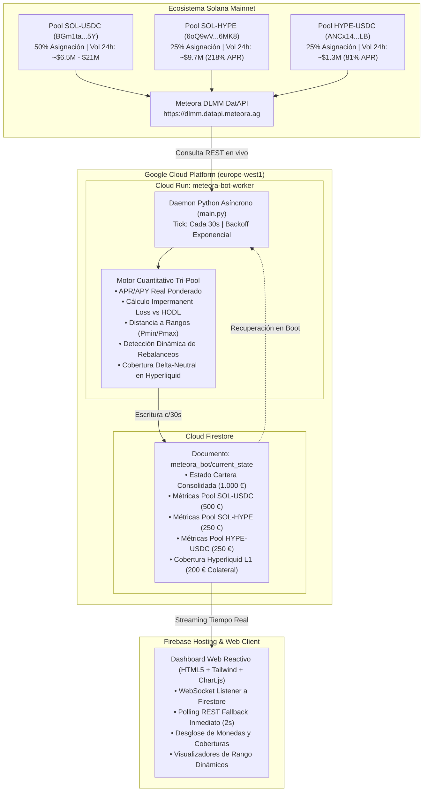

# CriptPool — Motor de Liquidez Concentrada Multi-Pool (Meteora DLMM)

[](https://solana.com)
[](https://meteora.ag)
[](https://cloud.google.com/run)
[](https://firebase.google.com)
[](https://firebase.google.com/docs/firestore)

Sistema cuantitativo institucional de provisión de liquidez concentrada (CLMM / DLMM) en la blockchain de Solana sobre los pools descentralizados de **Meteora AG**, desplegado en infraestructura serverless de alta disponibilidad en **Google Cloud Platform (GCP)**.

---

## 🌐 Enlaces del Proyecto en Producción

* **Dashboard Web en Vivo:** [https://criptpool-meteora.web.app](https://criptpool-meteora.web.app)
* **Worker Daemon en Cloud Run:** `https://meteora-dual-worker-724237130149.europe-west1.run.app`
* **Repositorio GitHub:** [https://github.com/PabloDorrego/CriptPool](https://github.com/PabloDorrego/CriptPool)
* **Proyecto GCP / Firebase:** `criptpool-meteora` (Región: `europe-west1`)

---

## 🏛️ Arquitectura del Sistema Multi-Pool



---

## 📈 Estrategia Tri-Pool Institucional (1.000,00 € / $1.080,00 USD)

El capital se distribuye bajo un modelo de optimización de **Ratio de Sharpe** combinando activos de reserva y alto volumen:

### 1. Motor Central — Pool SOL-USDC (50% = 500 € / $540 USD)
* **Dirección del Pool:** `5rCf1DM8LjKTw4YqhnoLcngyZYeNnQqztScTogYHAS6`
* **Rol:** **Generador Principal de Comisiones.** Captura el inmenso volumen del par rey de Solana.
* **Métricas Reales:** Mueve más de **$35.000.000 USD cada 24 horas**, con un APR dinámico muy elevado.
* **Configuración del Rango:** Horquilla de **±7.50%** respecto al precio de entrada.

### 2. Ancla Bitcoin — Pool cbBTC-USDC (25% = 250 € / $270 USD)
* **Dirección del Pool:** `7ubS3GccjhQY99AYNKXjNJqnXjaokEdfdV915xnCb96r`
* **Rol:** **Reserva de Valor Anticíclica.** Coinbase Wrapped Bitcoin cotizando contra dólares.
* **Métricas Reales:** Mueve más de **$3.500.000 USD cada 24 horas**, generando un **~35% - 50% APR real** con riesgo acotado.
* **Configuración del Rango:** Horquilla de **±6.00%**.

### 3. Acelerador Alpha — Pool HYPE-SOL (25% = 250 € / $270 USD)
* **Dirección del Pool:** `81GpCm4d13y8TozYtThabuSCLQN2o3bbrvDogXFPn8sA`
* **Rol:** **Acelerador de Alto Rendimiento.** Captura el explosivo volumen de swaps del ecosistema Hyperliquid en Solana.
* **Métricas Reales:** Genera entre **~80% y 150% APR real** en comisiones.
* **Configuración del Rango:** Horquilla de **±8.00%**.

---

## 🪙 Desglose de Asignación y Compra de Monedas

Para reproducir la operativa real con los 1.000 €:
1. **SOL-USDC (500 €):** 250 € comprados en SOL (`~2.95 SOL`) + 250 € en `USDC` (270 USDC).
2. **cbBTC-USDC (250 €):** 125 € comprados en Bitcoin (`~0.00175 cbBTC`) + 125 € en `USDC` (135 USDC).
3. **HYPE-SOL (250 €):** 125 € comprados en Hyperliquid (`~1.62 HYPE`) + 125 € en `SOL` (`~1.47 SOL`).

---

## 🎯 Panel de Control y KPIs (4 Columnas Comparativas)

El dashboard web compara las métricas en 4 columnas simultáneas:

| Categoría | Cartera Global (1.000 €) | Pool SOL-USDC (500 €) | Pool cbBTC-USDC (250 €) | Pool HYPE-SOL (250 €) |
| :--- | :--- | :--- | :--- | :--- |
| **1. Rendimiento** | • Comisiones Totales (€ y $)<br>• ROI Neto Consolidado<br>• APY Real Ponderado | • Comisiones en USD ($)<br>• APR Real de Fees<br>• Monedas en Pool | • Comisiones en USD ($)<br>• APR Real Bitcoin<br>• Monedas en Pool | • Comisiones en SOL y USD<br>• APR Real Alpha<br>• Monedas en Pool |
| **2. Riesgo** | • Impermanent Loss Consolidado<br>• Semáforo de Cobertura (Alpha)<br>• % Actividad In-Range Global | • Distancia a $P_{min}$ y $P_{max}$<br>• IL en USD vs. Fees<br>• Ratio de Actividad | • Distancia a $P_{min}$ y $P_{max}$<br>• IL en USD vs. Fees<br>• Ratio de Actividad | • Distancia a $P_{min}$ y $P_{max}$<br>• IL en SOL vs. Fees<br>• Ratio de Actividad |
| **3. Costes** | • Rebalanceos Totales<br>• Gasto Total de Red (Gas)<br>• Friction Ratio Global | • Rebalanceos del Pool<br>• Fricción de Gas ($)<br>• Eficiencia Operativa | • Rebalanceos del Pool<br>• Fricción de Gas ($)<br>• Eficiencia Operativa | • Rebalanceos del Pool<br>• Fricción de Gas (SOL)<br>• Eficiencia Operativa |

---

## 🛠️ Estructura del Repositorio

```bash
CriptPool/
├── cloud_deployment/
│   ├── bot_worker/
│   │   ├── Dockerfile                 # Contenedor optimizado Python 3.11 para Cloud Run
│   │   ├── main.py                    # Worker daemon asíncrono con persistencia en Firestore
│   │   ├── meteora_client.py          # Cliente HTTP con rate-limiting para Meteora DatAPI
│   │   └── requirements.txt           # Dependencias del servicio
│   ├── web_dashboard/
│   │   ├── public/
│   │   │   ├── index.html             # Dashboard responsive con vista de 4 columnas
│   │   │   └── app.js                 # Lógica cliente con WebSockets Firestore + REST Polling (2s)
│   │   ├── firebase.json              # Configuración de Firebase Hosting con directivas anti-caché
│   │   └── firestore.rules            # Reglas de seguridad declarativas de base de datos
│   ├── deploy_to_gcp.ps1              # Script de automatización para build y despliegue continuo
│   └── README_CLOUD.md                # Manual operativo del entorno Cloud
│
├── pair_selector_and_backtest.py      # Algoritmo de cribado y ranking de pares DLMM
├── simulate_clmm_viability.py         # Motor de simulación estocástica Monte Carlo
├── meteora_comprehensive_viability.py # Análisis exhaustivo de viabilidad y escala de capital
├── portfolio_diversification_study.py # Estudio de correlación y diversificación de carteras
├── Meteora_DLMM_Pair_Selection_and_DataDriven_Strategies.ipynb # Notebook interactivo de investigación
├── meteora_client.py                  # Módulo base de integración con la API de Meteora
├── INFORME_VIABILIDAD_METEORA_CLMM.md # Informe técnico cuantitativo de viabilidad
└── README.md                          # Documentación principal del proyecto
```

---

## 🚀 Despliegue y Ejecución

### 1. Ejecución Local del Worker
```powershell
pip install -r cloud_deployment/bot_worker/requirements.txt
python cloud_deployment/bot_worker/main.py
```

### 2. Despliegue en la Nube (GCP & Firebase)
```powershell
# Cloud Run
gcloud run deploy meteora-dual-worker --source "cloud_deployment/bot_worker" --region europe-west1 --platform managed --allow-unauthenticated --min-instances 1 --max-instances 1 --project criptpool-meteora

# Firebase Hosting
cd cloud_deployment/web_dashboard
npx firebase-tools deploy --only hosting --project criptpool-meteora
```

---

## 🔒 Seguridad y Persistencia Anti-Reseteos
* **Rutina `restore_persisted_state()`:** Recupera automáticamente de Firestore las comisiones históricas y las marcas de tiempo ante cualquier reinicio o actualización de contenedor, garantizando que ninguna comisión ganada se pierda.
* **Sincronización Inmediata:** El cliente web inicia el sondeo REST inmediatamente al abrir la página y se conecta en paralelo al WebSocket de Firestore para actualizaciones en vivo.
